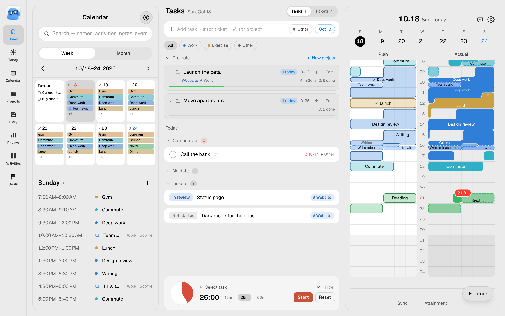
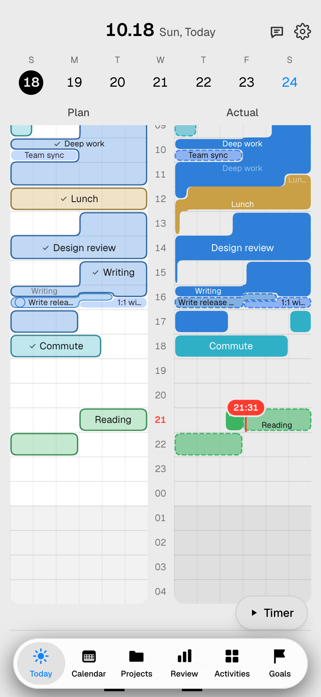
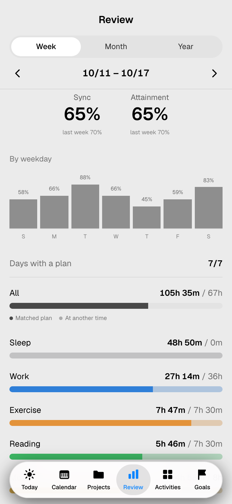
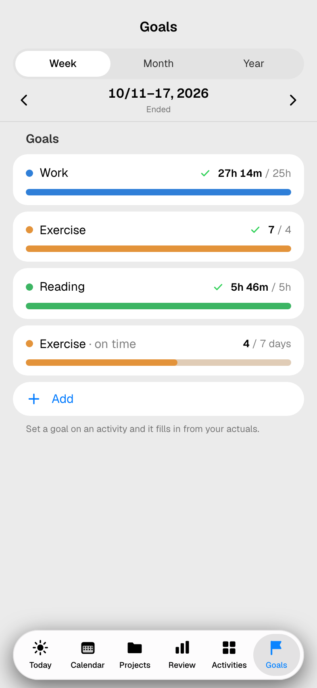
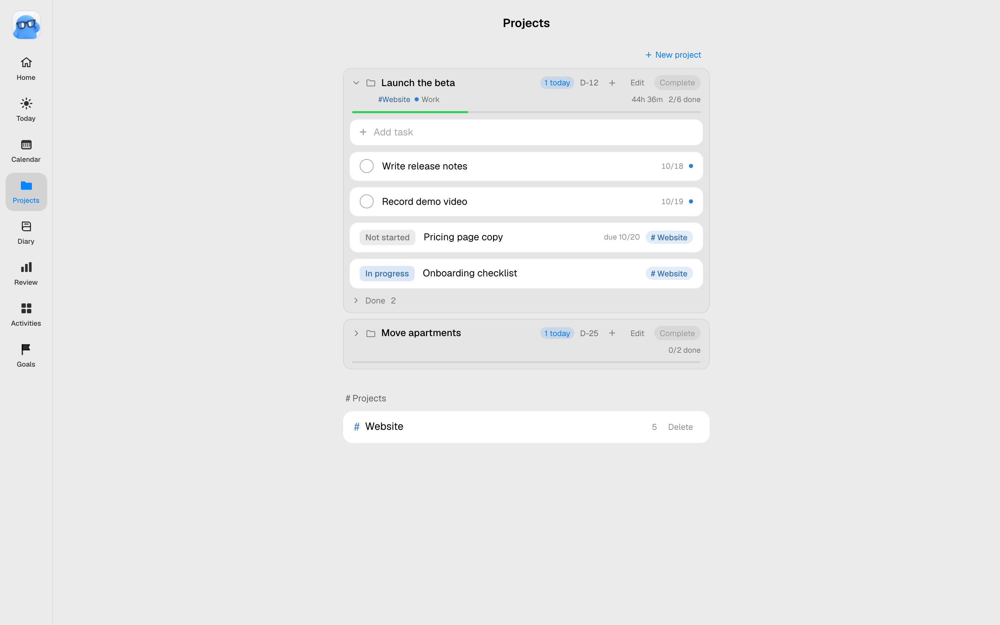
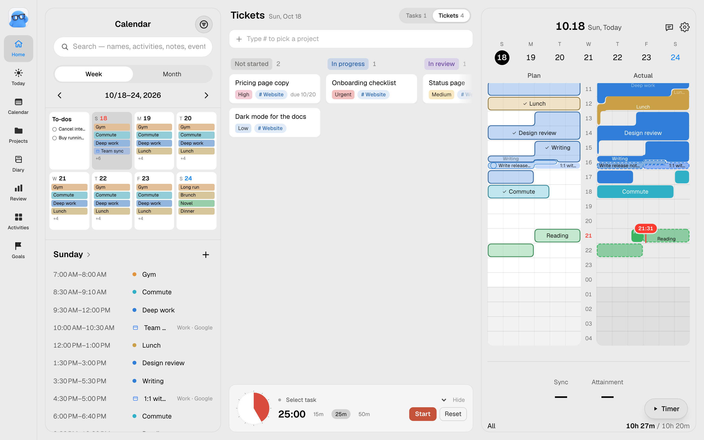
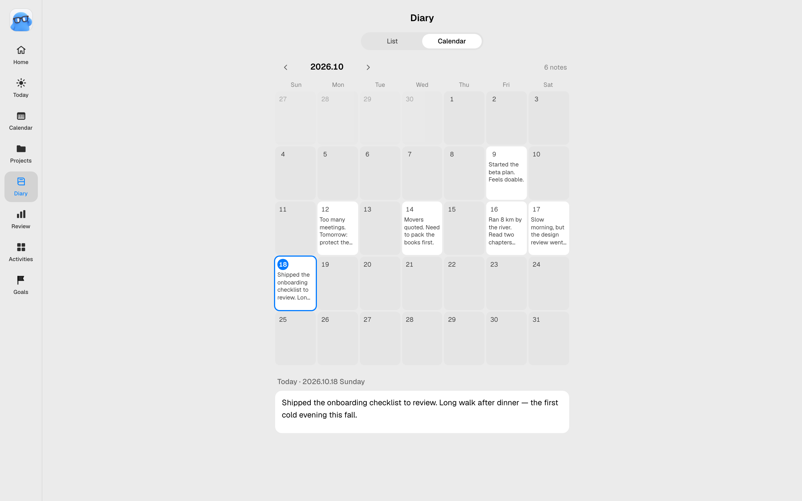
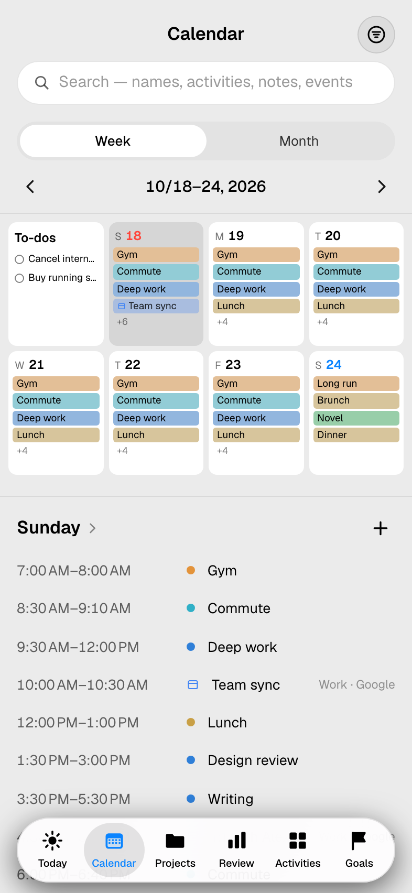
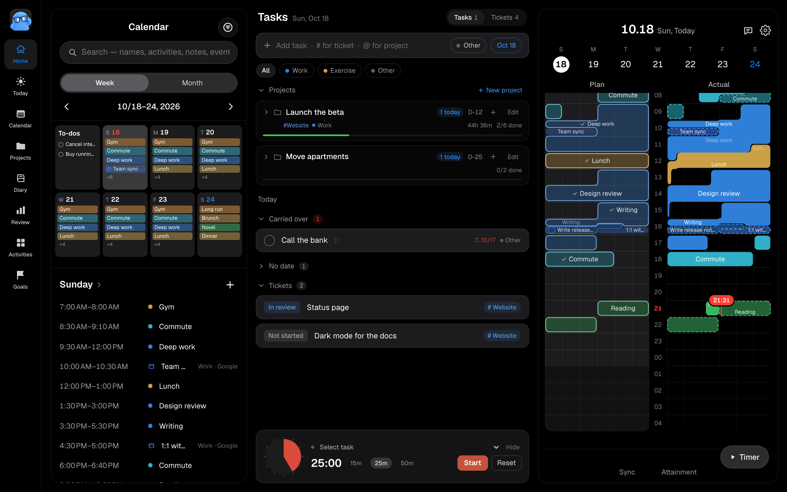

# Sync

**Plan your day on the left. Record what actually happened on the right. See how well the two line up.**

Sync is a day planner that also keeps your to-dos, projects, tickets, goals and a diary. It runs on
**your own computer**: there's no account to make and no cloud service, and your data never leaves
your machine. Your phone connects to it too.

[한국어 README](README.ko.md)



---

## Contents

1. [What you can do](#what-you-can-do)
2. [Install (one click)](#install-one-click)
3. [Your first day with Sync](#your-first-day-with-sync)
4. [Use it on your phone](#use-it-on-your-phone)
5. [Update, uninstall, back up](#update-uninstall-back-up)
6. [Troubleshooting](#troubleshooting)
7. [Calendars](#calendars)
8. [Connect your own task board, tracker or team calendar](#connect-your-own-task-board-tracker-or-team-calendar)
9. [For developers](#for-developers)
10. [License](#license)

---

## What you can do

| | |
| --- | --- |
|  | **Today.** Your plan on the left, what you actually did on the right, one row per hour.<br><br>Drag on empty space to add a block, drag a block to move it, or drag its edge to change its length.<br><br>Your calendar events show alongside (the dashed blocks); tap one to turn it into a plan. When a plan ends, Sync can ask whether you did it. |
|  | **Review.** Two scores for each week, month or year:<br>• **Sync %**: you did what you planned, when you planned it.<br>• **Attainment %**: you did it, even at another time.<br><br>See them by weekday and per activity, next to the previous period. |
|  | **Goals.** For example "25 hours of work this week", "exercise 4 times", "read 5 hours", or "start on time every day".<br><br>They fill up by themselves from what you record. |

| | |
| --- | --- |
|  | **Projects.** Group tasks and tickets toward one goal, with a due date and a progress bar. Complete a project once everything in it is done. |
|  | **Tickets.** A kanban board for bigger pieces of work. Type `#Website` in the add box to file a ticket on a project. |
|  | **Diary.** A short note for each day, as a list or a month calendar. |

Also included:
- a week and month **calendar** with search,
- a **pomodoro timer**,
- **undo/redo** (⌘Z / ⌘⇧Z),
- **dark mode**,
- an optional **chat assistant** that edits your plans for you ("gym tomorrow at 7 for an hour"),
- a **Mac menu bar** app that shows the current plan.

<p align="center"> &nbsp; </p>

---

## Install (one click)

You don't need to know anything about servers. The installer:
- gets everything Sync needs, including Node.js (the engine it runs on),
- sets Sync up to start by itself whenever you turn on the computer,
- opens it in your browser.

It takes about 5 minutes the first time.

### 1. Download

On this page, click the green **Code** button → **Download ZIP**. Then unzip it: double-click the ZIP
file. You can keep the folder anywhere, even in Downloads.

### 2. Run the installer

<table>
<tr><th>macOS</th><th>Windows</th><th>Linux</th></tr>
<tr valign="top">
<td>

Double-click **`Install Sync.command`**.

If macOS says it can't check the file for malicious software:
1. Open **System Settings → Privacy & Security**.
2. Scroll down and click **Open Anyway**.
3. Double-click the file again.

</td>
<td>

Double-click **`Install Sync.cmd`**.

If you see "Windows protected your PC", click **More info → Run anyway**.

</td>
<td>

In a terminal, in the unzipped folder:

```bash
bash "Install Sync.command"
```

</td>
</tr>
</table>

### 3. Answer one question

The installer asks how you'll use Sync:

```
Do you want to use Sync on your phone or another computer too?
  1) Not now — only on this computer (no password needed)
  2) Yes, with Tailscale — private, works anywhere (free app on both devices)
  3) Yes, on the same Wi-Fi — simplest, needs a password, only at home
```

If you're not sure, pick **1**. You can run the installer again any time to change it (see
[Use it on your phone](#use-it-on-your-phone)).

### 4. Done

The installer opens Sync in your browser. You can always find it at the address it prints, usually
**http://localhost:3000**. Bookmark it.

```
✓ Sync is installed and running.

  On this computer:  http://localhost:3000

  It starts by itself when you turn on the computer.
```

---

## Your first day with Sync

1. **Set when your day starts.** Click the gear icon, go to **Time**, and set **Day start time**
   (for example 05:00) and **Week starts on**.
2. **Look at your activities.** Every block belongs to an activity, and Sync starts with Sleep, Work,
   Exercise, Reading, Travel, Meal, Commute and Other. To rename them, change colours or add your
   own, use **Activities**.
3. **Plan.** Open **Today** (on a computer, **Home**). Drag down on empty space in the **Plan**
   column, choose an activity, and save.
4. **Record.** Do the same in the **Actual** column for what really happened. For a nudge, turn on
   Settings → Notification defaults → **End confirmation**: when a plan ends, Sync asks whether you
   did it (✓ / ✕), and ✓ records it for you.
5. **Add your calendars** (optional) in Settings → Accounts, so your meetings show next to your
   plans. See [Calendars](#calendars).
6. **After a few days**, open **Review** to see how your plans and your days compare, and set a few
   **Goals**.

> Want to look around first? A copy of Sync filled with sample data is described under
> [For developers](#for-developers).

---

## Use it on your phone

Sync runs on your computer, so your phone needs a way to reach it. Run the installer again and pick
one of these:

| | **Tailscale** (recommended) | **Same Wi-Fi** |
| --- | --- | --- |
| Works | anywhere: at work, on mobile data | only at home, on your Wi-Fi |
| Privacy | only your own devices can reach it | anyone on that Wi-Fi reaches the sign-in page |
| Password | on your other devices | on every device, including this computer |
| Setup | install the free Tailscale app on both devices | nothing |

**With Tailscale:**
1. Install [Tailscale](https://tailscale.com/download) on your computer and your phone, and sign in
   to the **same account** on both.
2. Run the installer again and choose **2**. It prints the address for your phone, something like
   `https://your-computer.tail1234.ts.net`.
3. If the installer says HTTPS isn't on, open the Tailscale admin console, go to **DNS**, enable
   **HTTPS Certificates**, and run the installer again.

**On the same Wi-Fi:** run the installer again and choose **3**. It prints an address like
`http://192.168.1.20:3000`. If your computer asks whether to allow incoming connections for "node",
choose **Allow**.

Either way, the installer gives you a **password** for your other devices (you can choose your own).
Then add Sync to your phone's home screen so it opens like an app:
- **iPhone:** in Safari, tap **Share → Add to Home Screen**.
- **Android:** in Chrome, tap the menu → **Install app**.

> Your computer has to be on (and not asleep) for your phone to reach Sync.

---

## Update, uninstall, back up

- **Update:** download the new ZIP and run the installer again. Your data and settings stay.
- **Uninstall:** double-click **`Uninstall Sync.command`** (or `Uninstall Sync.cmd` on Windows).
  Your data stays in its folder. To delete it too, delete that folder, or run the uninstaller from a
  terminal with `--purge`.
- **Back up:** go to Settings → Data → **Export backup**. That saves everything to one file, and
  **Import backup** brings it back.

Everything lives in one folder:

| | Folder |
| --- | --- |
| macOS | `~/Library/Application Support/Sync` |
| Windows | `%LOCALAPPDATA%\Sync` |
| Linux | `~/.local/share/sync` |

| Inside it | What it is |
| --- | --- |
| `data/` | Your plans, notes and everything else. Back this up. |
| `config.env` | Your settings and password. |
| `logs/` | Logs, for when something goes wrong. |
| `app/` | The program itself, replaced on every update. |

---

## Troubleshooting

| What you see | What to do |
| --- | --- |
| The browser says it can't connect | Sync starts a few seconds after the computer does, so wait a moment and reload. If it still fails, run the installer again. |
| My phone can't reach it | Check that the computer is on and awake. With Tailscale, make sure the app is connected on both devices; with Wi-Fi, make sure both are on the same network. |
| I forgot the password | Open `config.env` (see the table above), read or change `SYNC_PASSWORD`, then run the installer again. |
| The installer stopped with an error | Check your internet connection and run it again. Details are in `logs/install.log`. |
| "Can't decrypt saved calendar connections" | `SYNC_SECRET` in `config.env` was changed. Put the old value back, or delete `data/integrations.json` and connect your calendars again. |
| Something else | Look in `logs/server.log`, and [open an issue](../../issues) with what you see. |

---

## Calendars

Sync shows your calendar events next to your plans. It never changes them, except for a Mac calendar
you choose to save plans to.

- **Google Calendar:** the easiest way is an iCal link. In Google Calendar, open the calendar's
  **Settings → Integrate calendar** and copy the **Secret address in iCal format**. Then in Sync, go
  to **Settings → Add calendar by iCal link** and paste it.
- **iCloud:** create an app-specific password at [appleid.apple.com](https://appleid.apple.com)
  (**Sign-In and Security → App-Specific Passwords**). Then go to **Settings → Connect Apple (iCloud)
  Calendar**.
- **Everything in the Mac's Calendar app** (macOS): this includes shared and work calendars. Build
  the small helper once with `zsh tools/ekexport/build.sh` (needs Xcode's command line tools), then
  turn on **Settings → Accounts → This Mac’s calendars**. Plans can also be saved to a Mac calendar.
- **Calendars shared with you on Google:** `scripts/google-calendar-ics.gs` turns them into iCal
  links (the instructions are inside the file).
- **Google sign-in (OAuth):** for this instead of iCal links, see
  [Google sign-in for calendars](#google-sign-in-for-calendars).

---

## Connect your own task board, tracker or team calendar

Sync works fully on its own. If you already use another service, a **connector** keeps the two in
step:

- tasks sync both ways with Sync's to-dos (tasks with a start and end time become plans),
- your assigned tickets show on the Tickets board, with descriptions, history and comments,
- its calendars show, and it can provide sign-in.

There are two ways to connect a service:
- **Without writing any Sync code:** give your server a few simple JSON endpoints, then go to
  **Settings → Connector → REST server**.
- **For a service with its own API** (Todoist, Linear, GitHub Issues, …): write a small TypeScript
  connector.

Both are explained in [`src/lib/server/connectors/README.md`](src/lib/server/connectors/README.md).
`scripts/mock-connector.mjs` is a complete example server.

---

## For developers

### Run from source

You need Node.js 20.9 or newer.

```bash
git clone https://github.com/dryxco/sync-planner.git && cd sync-planner
npm install
npm run setup     # writes .env.local: a password and an encryption key
npm run build
npm start         # http://localhost:3000 — this computer needs no sign-in
```

`npm start` listens on this computer only by default. To listen on the whole network, set
`SYNC_HOST=0.0.0.0`; then every request needs the password. All settings are listed in
[`.env.example`](.env.example).

### How sign-in works

When Sync listens on this computer only, requests from this computer need no sign-in. Every other
request needs a session, which you get in one of these ways:
- with `SYNC_PASSWORD`,
- with a device-code sign-in from a server of your own: set `SYNC_LOGIN_URL`, and list the allowed
  users in `SYNC_ALLOWED_USERS`. The protocol is in the
  [connector README](src/lib/server/connectors/README.md#sign-in).

`SYNC_ALLOWED_TAILSCALE_USERS` can also limit which Tailscale accounts get through `tailscale serve`.
`SYNC_AUTH=off` turns sign-in off entirely; use it only where nobody else can reach the server.

### Google sign-in for calendars

1. In Google Cloud Console, enable the Google Calendar API.
2. Create an OAuth client of type *Web application* with the redirect URI
   `${APP_URL}/api/auth/google/callback`.
3. Put `GOOGLE_CLIENT_ID` and `GOOGLE_CLIENT_SECRET` in your config.
4. While the consent screen is in *Testing*, Google expires refresh tokens after 7 days, so publish
   the app (unverified apps still work for their owner).

### Try it with sample data

```bash
T=$(mktemp -d)
SYNC_DATA_DIR=$T SYNC_BIND=127.0.0.1 npx next start -H 127.0.0.1 -p 3320 &
node scripts/demo-data.mjs http://127.0.0.1:3320     # three weeks of made-up days
open http://127.0.0.1:3320
node scripts/readme-shots.mjs http://127.0.0.1:3320  # regenerates docs/screenshots/
```

### Checks

```bash
npm run lint && npx tsc --noEmit && npm test
```

The Playwright e2e scripts (`scripts/e2e-*.mjs`) run against a throwaway server, so they never
touch your data:

```bash
T=$(mktemp -d)
SYNC_DATA_DIR=$T SYNC_DISABLE_JOBS=1 SYNC_ALLOWED_USERS=good-user npx next start -p 3302 &
export SYNC_TEST_SESSION=$(node scripts/make-test-session.mjs $T good-user) SYNC_TEST_BASE=http://127.0.0.1:3302
node scripts/e2e-today.mjs $SYNC_TEST_BASE
```

Each script's header says what else it needs. For example, `e2e-connector.mjs` and `e2e-auth.mjs`
need `node scripts/mock-connector.mjs 3399`.

### Where things are

| Path | What |
| --- | --- |
| `src/app/`, `src/components/` | Pages and UI (Next.js App Router, React, Tailwind) |
| `src/lib/store.ts` | The client store (Zustand). Each browser keeps a full local copy. |
| `src/lib/server/syncdb.ts` | Server sync: per-record last-write-wins, with deletes kept as tombstones |
| `src/lib/server/connectors/` | The connector interface and the REST connector |
| `src/lib/server/task-sync.ts`, `ticket-sync.ts` | The connector sync engines (3-way merge) |
| `scripts/install.mjs`, `scripts/install/` | The one-click installer |
| `scripts/serve.mjs` | What `npm start` and the background service run |
| `tools/menubar`, `tools/ekexport` | The Mac menu bar app and the Mac Calendar helper (Swift) |

### Mac menu bar app

To set it up:
1. Build it with `zsh tools/menubar/build.sh`.
2. Copy `.bin/SyncMenuBar.app` to `/Applications` and open it.
3. Choose **Set up…** and enter your Sync address.
4. Paste the token from **Settings → Mac menu bar → Copy menu bar token**.

---

## License

Copyright © 2026 [dryxco](https://github.com/dryxco). Licensed under
[PolyForm Noncommercial 1.0.0](LICENSE.md).

You can use, change and share Sync for any noncommercial purpose: personal use, study, research,
hobby projects, and nonprofit, educational or government organizations. Commercial use isn't
allowed. For that, ask for a separate license.
